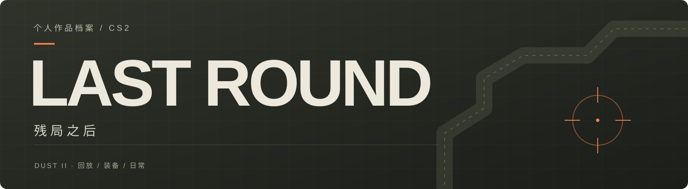

  

<h1 align="center">LAST ROUND · 残局之后</h1>

一个 CS 玩家的个人作品站。记下打过的回合，也留一点游戏之外的生活。

  
  
  
  

  <a href="https://927242768-dotcom.github.io/">在线网站</a> ·
  <a href="https://927242768-dotcom.github.io/admin/">作品后台</a> ·
  <a href="docs/README.md">维护文档</a> ·
  <a href="https://github.com/927242768-dotcom/last-round-cs/issues/new/choose">反馈问题</a>

---

## 关于这个项目

从 Dust II 的 A 小道开始，用实战回放、动漫角色和场景互动，记录一个 CS 爱好者的个人片段。页面使用原生 HTML、CSS 和 JavaScript；人物追视由不同视线方向的独立图像组成。

- **人物与场景**：角色追视、滚动叙事、档案箱和江边日常。
- **实战回放**：作品画廊、视频播放、关键时刻跳转与小道场景复盘。
- **装备互动**：装备桌上的步枪、刀与投掷物热点，对应真实回放片段。
- **作品管理**：新增、编辑、排序、上架、下架与素材上传。

## 两个仓库，各有分工

| 仓库 | 用途 | 日常维护入口 |
| --- | --- | --- |
| **[last-round-cs](https://github.com/927242768-dotcom/last-round-cs)** | 完整源码、构建工具、文档和 Node 服务 | 修改代码、阅读文档、提交问题 |
| [927242768-dotcom.github.io](https://github.com/927242768-dotcom/927242768-dotcom.github.io) | GitHub Pages 线上发布文件与作品数据 | 由作品后台保存内容，或发布经确认的构建产物 |

当前公开网站运行在 GitHub Pages。源码同时保留 Node.js 服务，支持使用 SQLite 和持久目录独立部署。两种模式的登录方式、存储和上传限制见[部署说明](docs/deployment.md)。

## 快速开始

需要 **Node.js 24.x**。项目使用 Node 内置模块，运行和构建无需安装第三方依赖。

~~~bash
git clone https://github.com/927242768-dotcom/last-round-cs.git
cd last-round-cs
npm run check
npm run build
~~~

构建结果位于 .local/pages-build/，不会自动发布到线上。

本地运行完整 Node 服务：

~~~powershell
# 首次运行：复制配置，并填写管理密码与随机会话密钥。
Copy-Item .env.example .env
npm run dev
~~~

打开 http://127.0.0.1:3000，后台入口为 /admin。完整配置、密钥生成和命令说明见[本地开发](docs/getting-started.md)。

## 目录

~~~text
last-round-cs/
├── public/                 # 网页、样式、交互和公开素材
├── server/                 # 作品接口、登录校验和媒体处理
├── hosting/                # Node 服务、持久存储与 Pages 后台适配
├── drizzle/                # SQLite 数据库迁移
├── scripts/                # Pages 构建与仓库检查
├── docs/                   # 开发、部署、内容维护与素材说明
├── .github/                # 持续检查、问题模板与 PR 模板
├── .env.example            # 本地配置示例，不含真实密钥
├── Dockerfile              # 独立容器部署入口
└── package.json            # 项目信息与维护命令
~~~

## 维护文档

| 想做什么 | 阅读 |
| --- | --- |
| 在本机运行与检查 | [本地开发](docs/getting-started.md) |
| 了解前台、后台和数据的关系 | [项目结构](docs/architecture.md) |
| 发布 Pages 或部署 Node 服务 | [部署与备份](docs/deployment.md) |
| 管理作品、上传素材与调整排序 | [内容管理](docs/content-management.md) |
| 排查登录、更新和视频问题 | [常见问题](docs/faq.md) |
| 查看字体和视觉素材的来源 | [素材与致谢](docs/credits.md) |

## 参与维护

提交问题或改动前，请阅读[协作说明](CONTRIBUTING.md)。涉及令牌、登录或访问控制的问题，请按[安全说明](SECURITY.md)私下报告。仓库整理记录见[更新记录](CHANGELOG.md)。

## 版权

源码与站点素材公开用于展示和维护，**目前未授予开源使用许可**。第三方字体按其自带许可证使用；Counter-Strike 相关内容及商标的权利归相应权利人所有。详情见 [LICENSE](LICENSE) 和[素材与致谢](docs/credits.md)。
